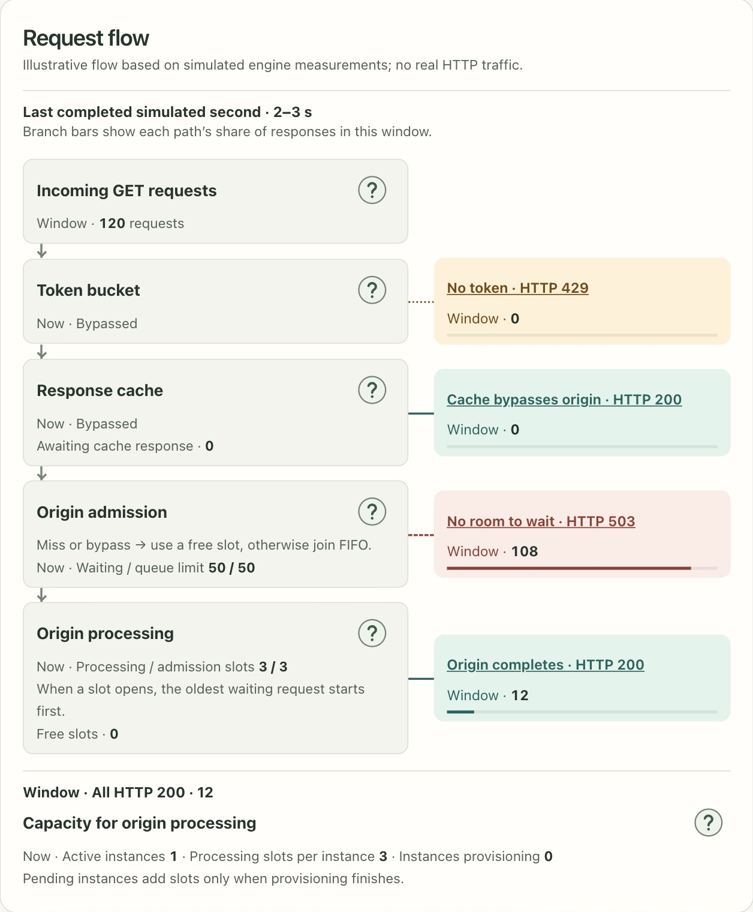
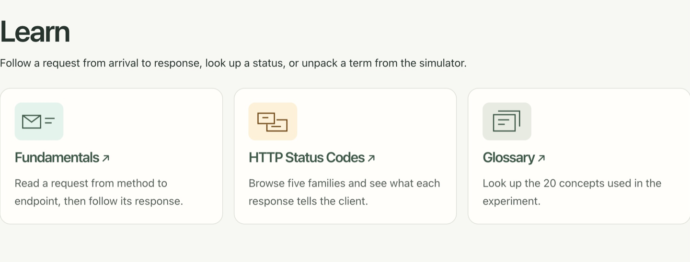
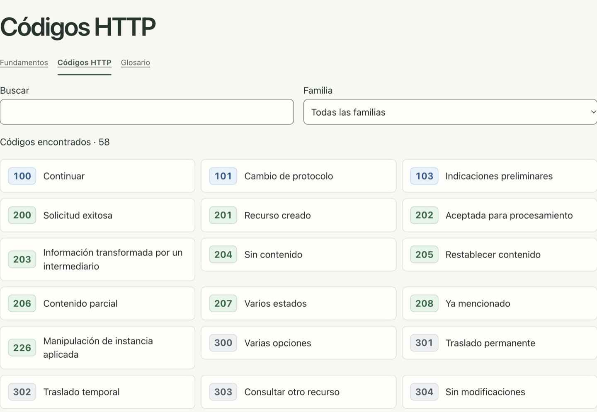

# Break My API

**What happens when 120 requests arrive each second and your API can finish only 12?**

Break My API lets you run that experiment in your browser. If you’re learning how APIs work, follow a request from arrival to response. If you already build services, try changing one constraint at a time and see where requests start waiting or getting rejected. The Playground and learning materials are available in English and Spanish. All traffic is synthetic.



*Traffic Spike, paused after the 2–3 second window. All three processing slots are busy. The 50 requests already waiting keep their places.*

## Try an experiment

Use Node.js 24 and npm. Run these commands from the repository root.

```sh
npm ci
npm run dev
```

Open the local URL printed by Vite, choose **Open Playground**, select **Traffic Spike**, and press **Start**. Watch the incoming rate and successful completions for the first full simulated second. Then pause and inspect the flow. Each help button explains the adjacent setting or measurement. Choosing another scenario restores its defaults and clears the previous history.

## What can you explore?

- **Find the bottleneck.** Start with Healthy, then raise incoming traffic or lengthen processing time. Compare adding a processing slot with adding a queue place. One lets more work run at once. The other gives a request somewhere to wait.
- **Separate two kinds of rejection.** Turn on the token bucket and lower its admission cap to see HTTP 429. Leave it bypassed and fill the queue to see HTTP 503. The flow shows where each decision happened.
- **Try Cache Rescue.** Eligible GET hits take a short simulated response path around the origin. Compare cache and origin completions to see how much work still reaches processing.
- **Watch capacity arrive.** In Auto Scale Recovery, pause at two simulated seconds to inspect a pending instance. Resume to four seconds to see it become active. Earlier overflow responses remain in the totals.
- **Read the evidence.** The flow counts responses by path for the last completed simulated second. Queue depth and occupied slots describe the current instant. Observed p95 uses end-to-end latencies from successful completions in the window. The history charts also have a keyboard-accessible data table.

## Explore the learning center



Follow the fictional request in Fundamentals, look up one of 20 glossary terms, or switch between Simple and Technical explanations. You can visit Learn during an experiment and return to the same run. The optional three-step Playground tour includes a local example of `GET /api/products`. Sending that example makes no network call and leaves the experiment counters alone.



The Explorer documents **58 HTTP codes** across all five families. Search by code or keyword, filter by family, or share a detail path such as `/learn/http-status?code=429`. Each detail identifies whether the Playground produces that outcome. Its three simulated responses are **200, 429, and 503**.

## How it works

A pure TypeScript engine schedules arrivals, refills the token bucket, and checks the cache for admitted requests. An origin-bound request starts in a free slot, waits in FIFO order, or receives a 503 if the waiting room is full. A cache response and an origin response both count as 200 when they complete. Arrivals and completions in a particular second can belong to different requests.

The app uses React, Vite, native SVG charts, and CSS. The engine runs entirely in browser memory and requires no backend or target URL. Seeded cache decisions, fixed service times, and a bounded scaling policy make experiments repeatable. These assumptions help isolate tradeoffs. They leave out network variability, storage contention, and provider-specific behavior that matter for production capacity planning.

## Development

```sh
npm run typecheck
npm run lint
npm test -- --run
npm run build
```

Vitest and Testing Library cover engine behavior and interface interactions. To inspect the production build locally, run `npm run preview` after building. For timing, measurement windows, and accounting rules, see the [simulation model](docs/05-SIMULATION-ENGINE.md).
